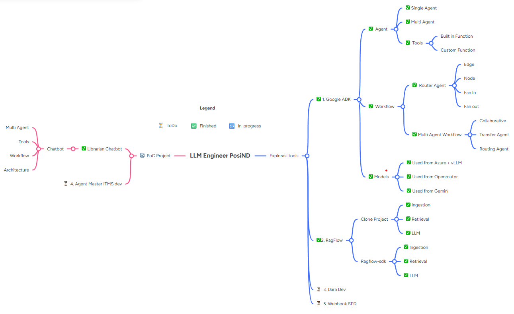

# intern-pos-llm

Kode dan catatan selama magang sebagai LLM Engineer. Isinya eksplorasi Google ADK, RAGFlow, dan LightRAG, ditambah satu PoC: chatbot dokumen multi-agent bernama Smart Library.

## Isi repo

| Folder / file | Isi |
| --- | --- |
| [`Research/`](Research/) | Agent latihan saat belajar ADK: single agent, tools, dan workflow router dengan RAGFlow |
| [`smart-library/`](smart-library/) | PoC chatbot dokumen: ADK multi-agent dengan backend RAGFlow atau LightRAG |
| [`docs/dokumentasi-teknis.docx`](docs/dokumentasi-teknis.docx) | Dokumentasi teknis hasil riset: cara kerja ADK, RAGFlow, LightRAG, perbandingan, dan kendala yang ditemui |
| `smart-library/catatan-belajar/` | Catatan pribadi langkah demi langkah (setup, tutorial per bab, troubleshooting) |
| `Mindmap-progress.png` | Peta progres eksplorasi |

Kalau baru pertama kali membuka repo ini, mulai dari dokumentasi teknis untuk gambaran besarnya. Lalu lihat `smart-library/README.md` kalau ingin menjalankan chatbot-nya.

## Status

- **Smart Library v1** (19 November 2026): orchestrator dengan empat sub-agent, dua workflow (upload dan bandingkan), dan dua backend. Sudah diuji ke RAGFlow dan LightRAG sungguhan dengan 13 dokumen publik.
- **v2** sedang dikerjakan terpisah. Isinya router workflow yang eksplisit, lapisan konteks percakapan, pencarian yang tidak menuntut nama file, dan model Qwen (Alibaba Model Studio).

## Catatan

Semua dokumen uji adalah dokumen publik: regulasi dari JDIH BPK, dokumen BRIN, ai.gov.au, data ITU, dan paper arXiv. File-filenya tidak disimpan di repo; daftar sumbernya ada di `smart-library/data/sources.yaml`. Tidak ada data internal tempat magang di repo ini.

Kunci API tidak ikut di-commit. Setiap folder punya `.env.example` sebagai contoh.
