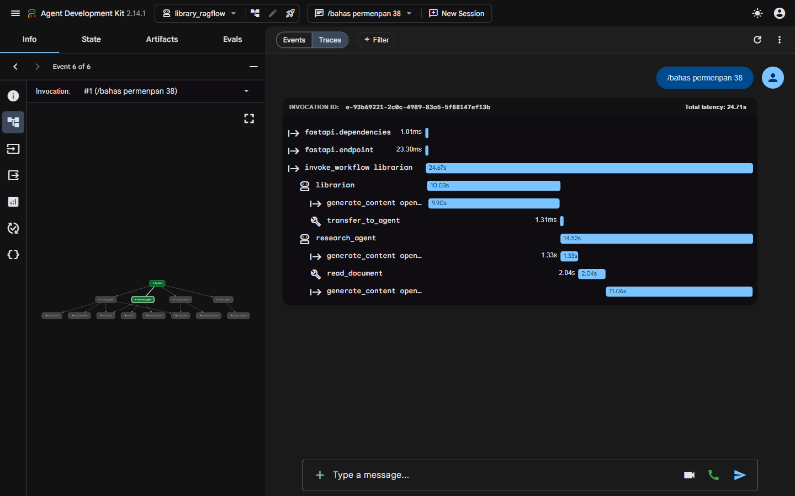

# Smart Library

Chatbot dokumen yang dibangun dengan Google ADK 2.x. Pengguna bisa melihat koleksi, mengupload file, bertanya, membahas satu dokumen, dan membandingkan dokumen atau dataset. Backend retrieval-nya bisa ditukar: RAGFlow atau LightRAG.

Versi ini (v1) dibuat untuk belajar dan sebagai PoC. Agent yang sama dijalankan di atas dua backend supaya keduanya bisa dibandingkan dengan adil.



## Cara kerjanya

```
adk web  (pilih library_ragflow atau library_lightrag)
   │
librarian  (orchestrator, mengenali maksud dan shortcut)
   ├── catalog_agent   daftar dataset & dokumen
   ├── ingest_agent    ingest_pipeline (workflow): load → upload → parse → tunggu → lapor
   ├── research_agent  cari & bahas, dengan kutipan halaman
   └── compare_agent   compare_pipeline (workflow): resolve target → retrieval paralel → bukti
   │
RagBackend (7 method)
   ├── RAGFlow  (Docker, UI http://localhost)
   └── LightRAG Server  (satu proses per dataset, WebUI :9621 / :9622)
```

Backend hanya dipakai untuk mengambil potongan dokumen. Jawaban selalu ditulis oleh agent ADK yang sama, dengan LLM dan embedding yang sama.

## Shortcut

Pertanyaan bebas juga bisa, tapi shortcut ini membantu:

| Ketik | Hasil |
| --- | --- |
| `/dataset [nama]` | Daftar dataset, atau dokumen di satu dataset beserta status parsing |
| `/cari <kata kunci>` | Jawaban dengan kutipan `[n] dokumen, hlm.` |
| `/bahas <dokumen>` | Ringkasan dan diskusi lanjutan tentang satu dokumen |
| `/bandingkan A vs B [: fokus]` | Tabel perbandingan file dengan file, dataset dengan dataset, atau campuran |
| `/upload [dataset]` | Simpan file yang dilampirkan di chat |

Nama dokumen boleh tidak persis, misalnya "uu pdp" atau "paper lightrag".

## Menjalankan

Butuh uv, Docker Desktop, dan endpoint LLM yang kompatibel OpenAI (chat + embedding). Langkah lengkapnya ada di [catatan-belajar/01-setup.md](catatan-belajar/01-setup.md).

```powershell
uv sync --all-groups
copy .env.example .env               # isi endpoint, key, dan RAGFLOW_API_KEY
# RAGFlow: docker compose up -d di repo ragflow, login UI, tambah model provider, buat API key
uv run lightrag-up                   # terminal terpisah
uv run seed --backend all            # unduh dokumen publik, buat dataset, parse
uv run adk web agents                # http://localhost:8000
```

Laptop dengan RAM 16 GB sebaiknya hanya menjalankan satu backend dalam satu waktu. RAGFlow + Elasticsearch saja memakai sekitar 6 GB saat parsing.

## Koleksi uji

| Dataset | Dokumen |
| --- | --- |
| Regulasi Digital ID | UU 27/2022 PDP, UU 1/2024 (ITE), PP 71/2019, Perpres 95/2018, Stranas KA 2020–2045, AI Policy Guide and Template (National AI Centre, `.docx`), data pengguna internet ITU (`.csv`) |
| Riset RAG | RAG (Lewis 2020), LightRAG, GraphRAG, RAPTOR, Self-RAG, survei RAG (Gao 2023) |

Daftar URL dan lisensinya ada di [`data/sources.yaml`](data/sources.yaml).

## Hasil perbandingan

Sepuluh pertanyaan, agent dan LLM sama (Azure gpt-5.1, text-embedding-3-small):

| Jenis | RAGFlow | LightRAG |
| --- | --- | --- |
| Fakta | 4,75 | 3,50 |
| Bandingkan | 4,33 | 5,00 |
| Relasional | 3,33 | 3,33 |
| **Total** | **4,20** | **3,90** |

Median latensi 20 detik (RAGFlow) dan 37 detik (LightRAG). Detail per pertanyaan ada di [`eval/results/2026-11-19.md`](eval/results/2026-11-19.md). Analisisnya ada di dokumentasi teknis (`../docs/dokumentasi-teknis.docx`).

## Struktur

```
agents/library_*/       entry point adk web
src/smart_library/
  agents/ + prompts/    satu file per agent, persona di .md
  tools/                function tools
  workflows/            ingest_pipeline, compare_pipeline
  backends/             interface + adapter RAGFlow dan LightRAG
  cli/                  seed, eval, lightrag-up
data/sources.yaml       daftar dokumen publik
eval/                   pertanyaan uji dan hasil
tests/                  unit (tanpa layanan), integration (backend asli), eval (adk eval)
prd/PRD.md              kebutuhan produk
catatan-belajar/        catatan dan tutorial pribadi
laporan/                laporan progres 19 November 2026
```

## Test

```powershell
uv run pytest                    # unit test, tidak butuh layanan
uv run pytest -m integration     # butuh RAGFlow, LightRAG, dan LLM
uv run pytest -m eval            # adk eval untuk routing agent
uv run eval                      # perbandingan RAGFlow vs LightRAG
```

## Keterbatasan yang diketahui

- Bot masih terlalu bergantung pada shortcut dan nama dokumen. Ini yang diperbaiki di v2 dengan router workflow dan lapisan konteks.
- LightRAG butuh satu server per dataset, dan filter per dokumen dilakukan setelah retrieval.
- Hasil perbandingan berasal dari 10 pertanyaan dan satu run, jadi sifatnya indikatif.
