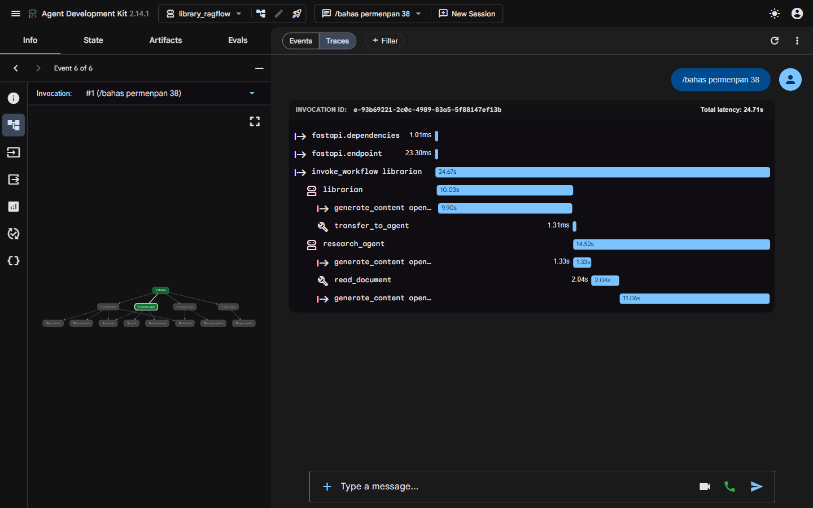

# 05 · Orchestrator, sub-agent, mode, dan persona

**Tujuan:** memahami arsitektur multi-agent Smart Library dan tiga *mode* sub-agent di ADK 2.x.

## Arsitektur

```
librarian (root, orchestrator)          ← persona: prompts/librarian.md
├── catalog_agent   mode="task"         ← list_datasets, list_documents, set_scope
├── ingest_agent    mode="single_turn"  ← ingest_pipeline (Workflow)
├── research_agent  mode="chat"         ← search, read_document, set_scope
└── compare_agent   mode="task"         ← compare_pipeline (Workflow)
```

Lihat graf ini di panel kiri `adk web` (ikon *agent graph*):



## Tiga mode sub-agent (ADK 2.14)

| Mode | Cara dipanggil parent | Melihat chat? | Selesai bagaimana | Dipakai untuk |
|---|---|---|---|---|
| `chat` (default) | `transfer_to_agent` | Ya, seluruh riwayat | User terus mengobrol dengannya, bisa transfer balik | `research_agent`, untuk diskusi multi-turn |
| `task` | Dibungkus jadi **tool** bernama agent itu | Ya | Memanggil `finish_task(result=...)` lalu kendali kembali ke parent | `catalog_agent`, `compare_agent` |
| `single_turn` | Dibungkus jadi **tool** | **Tidak**, hanya menerima `request` dari parent | Jawaban pertama = hasil | `ingest_agent` (cukup nama file + dataset) |

Bukti dari source ADK: `LlmAgent.model_post_init` menambahkan `_TaskAgentTool` / `_SingleTurnAgentTool` untuk sub-agent ber-mode `task` / `single_turn`.

### Dua pelajaran dari uji asli

1. **Task agent harus menaruh jawaban lengkap di `finish_task`.** Awalnya `catalog_agent` hanya mengirim ringkasan ("Menampilkan daftar dataset") sehingga tabelnya tidak sampai ke user. Perbaikannya ada di persona (`catalog.md`, `compare.md`), dan librarian diminta meneruskan `result` apa adanya.
2. **`single_turn` tidak melihat chat.** Karena itu persona librarian mewajibkan nama file persis (`[Uploaded Artifact: "x.pdf"]`) dan dataset tujuan ikut dikirim di request.

## Persona = file Markdown

`src/smart_library/prompts/*.md` dimuat oleh `load_prompt()` ([`agents/__init__.py:6`](../src/smart_library/agents/__init__.py)). Struktur tiap persona: **Persona → Tugas → Format jawaban → Aturan kejujuran/larangan**.

- Ganti gaya bicara atau aturan tanpa menyentuh Python.
- `<<BACKEND>>` di `librarian.md` diganti nama backend saat build (`agents/librarian.py`).
- Jangan menulis `{...}` di persona, karena ADK menganggapnya placeholder state (`test_prompts_complete` menjaganya).

## Shortcut

Shortcut dikenali librarian lewat instruksi, bukan kode. Jadi shortcut tetap jalan di UI mana pun (adk web, API, Slack…):

| Shortcut | → |
|---|---|
| `/dataset [nama]` | catalog_agent |
| `/cari <query>` | research_agent |
| `/bahas <dokumen>` | research_agent (`read_document` sekaligus mengunci scope) |
| `/bandingkan A vs B [vs C] [: fokus]` | compare_agent |
| `/upload [dataset]` | ingest_agent |
| `/bantuan` | librarian |

## Upload file dari chat

`App(plugins=[SaveFilesAsArtifactsPlugin()])` ([`app.py:16`](../src/smart_library/app.py)) menyimpan lampiran sebagai artifact dan menggantinya dengan teks `[Uploaded Artifact: "nama"]`. Node `load_file` membacanya dengan `ctx.load_artifact(nama)`. Batas plugin 20 MB.

## Struktur sesuai best practice ADK

- `agents/<nama>/__init__.py` berisi `from . import agent`, dan `agent.py` mengekspor **`app = App(...)`** (loader `adk web` mencari `app` lebih dulu, baru `root_agent`).
- Jalankan dari folder induk: `uv run adk web agents`.
- `adk web` untuk development. Untuk produksi lihat [08](08-bikin-produk-sendiri.md).

## Coba sendiri

1. Ubah `research_agent` menjadi `mode="task"`. Bisakah kamu masih bertanya lanjutan tentang dokumen yang sama? Kenapa?
2. Tambahkan shortcut `/ringkas-dataset <nama>` di `librarian.md` yang diteruskan ke research_agent dengan scope dataset.
3. Lihat tab **State** setelah `/bahas uu pdp`: apa isi `scope`?

## Kesalahan umum

| Gejala | Solusi |
|---|---|
| Hasil task agent cuma kalimat pendek | `finish_task` harus berisi jawaban lengkap (lihat pelajaran 1) |
| ingest_agent bilang "nama file tidak ada" | Librarian tidak meneruskan nama artifact; perjelas persona |
| Peringatan `no context_cache_config` | Itu fitur cache Gemini. Dengan Azure via LiteLLM bisa diabaikan |
| Librarian lambat (±10 s per hop) | Wajar untuk `gpt-5.1` (reasoning). Bisa diganti model lebih cepat via `LLM_MODEL` |
